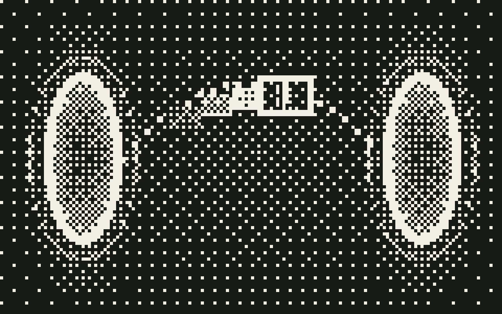

<p align="center">
  
</p>

<h1 align="center">teleport</h1>

<p align="center">
  <strong>Pack a coding-agent session into one zip and resume it on another machine or harness.</strong>
</p>

<p align="center">
  <a href="#harness-support"></a>
  <a href="https://github.com/sisig-ai/teleport/tree/main/skill/scripts"></a>
  <a href="./LICENSE"></a>
</p>

<p align="center">
  <a href="#quick-start">Quick start</a> ·
  <a href="#usage">Usage</a> ·
  <a href="#how-it-works">How it works</a> ·
  <a href="#contributing">Contributing</a>
</p>

The payload is harness-agnostic: three plain markdown files carry the meaning, and raw session history rides along as a best-effort attachment. It works with claude, cursor, codex, opencode, goose, and pi.

## Features

- Carries `SUMMARY.md`, `FILES.md`, and `LEARNINGS.md`, plus raw session history as a best-effort attachment.
- Auto-detects every harness on the machine (claude, cursor, codex, opencode, goose, pi) and installs the teleport skill to each one.
- Sends uncommitted work as `uncommitted.patch` inside the zip, or commits it to branch `teleport/<name>` with `--branch`.
- Works on a harness with no teleport install, because the bundle carries `_teleport/` with the unpack script and `SKILL.md`.
- Sends the zip to another host with `/teleport to`.

## Quick start

```bash
git clone https://github.com/sisig-ai/teleport.git
cd teleport
./install.sh
```

This auto-detects every harness on your machine (claude, cursor, codex, opencode, goose, pi) and installs the teleport skill to each one. No arguments needed.

After install, run `/teleport` or say "teleport this session" in any supported harness.

## Usage

### Install options

To install for a specific harness only:

```bash
./install.sh claude        # just claude
./install.sh goose cursor  # multiple harnesses
```

To install at project level (claude and cursor only):

```bash
./install.sh --project /path/to/repo
```

### Pack

```
/teleport
```

The agent writes `SUMMARY.md`, `FILES.md`, `LEARNINGS.md` to `.teleport/`, then runs
`teleport-pack.sh` to build `teleport-<name>.zip` in the repo root.

Pack script flags:

| Flag | Effect |
|------|--------|
| `--name a-b` | Pick the bundle name instead of a random `word-word` |
| `--history FILE` | Attach a session history file (repeatable) |
| `--context FILE` | Attach an extra handoff file (repeatable) |
| `--harness NAME` | Explicitly set source harness label (claude\|cursor\|codex\|opencode\|goose\|pi) |
| `--branch` / `--push` | Commit uncommitted work to branch `teleport/<name>` and push to `origin` |
| `--max-mb N` | Raise the size preflight cap (default 200 mb of changed + untracked files) |

Without `--branch`, uncommitted work travels as `uncommitted.patch` inside the zip.

### From

```
/teleport from teleport-rainbow-unicorn.zip
```

This extracts the bundle, reads `RESUME.md` and the three md files, and resumes the session.
The agent follows the restore steps in `RESUME.md` (branch checkout or patch apply) and asks
before it changes the working tree.

Manual unpack, with or without the skill installed:

```
skill/scripts/teleport-unpack.sh teleport-rainbow-unicorn.zip
```

(A bundle also carries the unpack script inside `_teleport/`.)

### To

```
/teleport to coder@dev-workstation codex
```

This packs, then `scp`s the zip to the host, then prints the command to run there.

## How it works

### Bundle layout

```
teleport-<name>.zip
└── teleport-<name>/
    ├── MANIFEST.json        # name, created_at, source, git state, transport, history mode
    ├── SUMMARY.md           # goal, what was done, what is planned, direction
    ├── FILES.md             # files touched this session + change overview
    ├── LEARNINGS.md         # findings, gotchas, key numbers, decisions
    ├── RESUME.md            # boot instructions for the successor agent
    ├── uncommitted.patch    # diff vs head, binary, omitted when the tree is clean
    ├── history/             # raw session history, best effort
    ├── context/             # extra handoff files
    └── _teleport/           # unpack.sh + SKILL.md, for a host with no teleport installed
```

### Harness support

| Harness  | Status                                                       |
|----------|--------------------------------------------------------------|
| claude   | ✅ verified: auto-detect, pack, unpack, skill install        |
| cursor   | ✅ verified: auto-detect, pack, unpack, skill install        |
| codex    | ✅ verified: auto-detect, pack, unpack, skill install        |
| opencode | ✅ verified: auto-detect, pack, unpack, skill install        |
| goose    | ✅ verified: auto-detect, pack, unpack, skill install        |
| pi       | ✅ verified: auto-detect, pack, unpack, skill install        |

A bundle works even on a harness with no teleport install: it carries `_teleport/` with the
unpack script and `SKILL.md`, and `RESUME.md` gives plain restore steps.

## Limitations

- Submodule content is not packed when the submodule is dirty. The manifest flags it.
- No history format conversion between harnesses. `history/` is a raw, best-effort attachment.

## Development

```
bash test/smoke.sh
```

This runs 12 assertions against a fixture repo in a temp sandbox: patch apply with deletion,
missing and empty learnings file, `--branch` transport with push and second-clone restore,
patch transport, subdir invocation, in-progress merge, zip-path-traversal and symlink
rejection with exact messages, unborn head, secret-scan flagging, and ambiguous codex
history detection.

## Contributing

Issues and PRs are welcome. Run `bash test/smoke.sh` before you open a PR.

## License

MIT, see [LICENSE](./LICENSE).
